# HelpFlow - Sistema Integral de Gestion de Soporte TI

[](https://github.com/JuanGale-20/HelpFlow)
[](https://adoptium.net/)
[](https://spring.io/projects/spring-boot)
[-blue.svg)]()
[](https://www.postgresql.org/)
[](https://www.docker.com/)

**Repositorio publico:** [https://github.com/JuanGale-20/HelpFlow.git](https://github.com/JuanGale-20/HelpFlow.git)

HelpFlow es una solucion empresarial para el registro, priorizacion, asignacion tecnica inteligente, control de acuerdos de nivel de servicio (SLA) y resolucion de incidentes tecnologicos en organizaciones multi-sede.

El sistema se estructura mediante dos microservicios desacoplados:
* **support-ticket-service (Puerto 8080):** Servicio central implementado bajo arquitectura hexagonal estricta (Ports and Adapters). Contiene el modelo de dominio puro, persistencia relacional optimizada con JPA en PostgreSQL, migraciones de base de datos automatizadas con Flyway, autenticacion stateless con JWT, manejo de errores estandarizado RFC 7807 (ProblemDetail) y observabilidad integral con Micrometer y Prometheus.
* **technician-dispatch-service (Puerto 8081):** Microservicio simulado y determinista que procesa la categoria, prioridad e identificador del ticket para sugerir el tecnico optimo y su disponibilidad estimada.

---

## 1. Diagrama de Arquitectura Hexagonal

El diseno del servicio central asegura un desacoplamiento total: el nucleo de dominio no posee dependencias de frameworks ni de infraestructura externa.

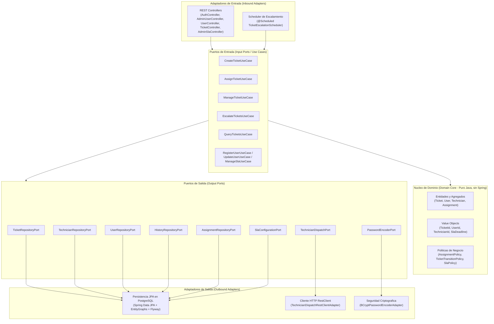

---

## 2. Catalogo de Endpoints

### 2.1. Autenticacion y Usuarios
| Metodo | Ruta | Descripcion | Acceso |
| :--- | :--- | :--- | :--- |
| `POST` | `/auth/register` | Registro de nuevos usuarios (crea siempre `ROLE_USUARIO`) | Publico |
| `POST` | `/auth/login` | Autenticacion que genera token Bearer JWT | Publico |
| `POST` | `/admin/users` | Creacion administrativa de tecnicos (`ROLE_TECNICO`) y administradores | Solo Admin |
| `PUT` | `/users/{id}` | Actualizacion de datos de perfil (nombre, sede, area) | Propio Usuario o Admin |

### 2.2. Gestion de Tickets (`/tickets`)
| Metodo | Ruta | Descripcion | Acceso |
| :--- | :--- | :--- | :--- |
| `POST` | `/tickets` | Creacion y auto-asignacion inmediata de ticket | Usuario / Admin |
| `GET` | `/tickets` | Listado de tickets segun rol del usuario | Autenticado |
| `GET` | `/tickets/{id}` | Consulta detallada del ticket con validacion de autorizacion | Autenticado |
| `GET` | `/tickets/{id}/history` | Historial cronologico de asignaciones y estados | Autenticado |
| `PATCH` | `/tickets/{id}/status` | Transicion de estado (`status`, `observation`) con validacion cruzada | Tecnico / Admin / Creador |
| `POST` | `/tickets/{id}/assign` | Reasignacion manual de tecnico | Solo Admin |

### 2.3. Politicas de SLA (`/admin/sla`)
| Metodo | Ruta | Descripcion | Acceso |
| :--- | :--- | :--- | :--- |
| `GET` | `/admin/sla` | Lista de horas limite configuradas por prioridad | Solo Admin |
| `PUT` | `/admin/sla` | Actualizacion del tiempo maximo de resolucion SLA con validacion jerarquica | Solo Admin |

### 2.4. Microservicio de Despacho Tecnico (Puerto 8081)
| Metodo | Ruta | Descripcion | Acceso |
| :--- | :--- | :--- | :--- |
| `POST` | `/technician-dispatch` | Estimacion determinista de tecnico y tiempo | Interno / Publico |

### 2.5. Actuator y Monitoreo (Ambos servicios)
| Metodo | Ruta | Descripcion |
| :--- | :--- | :--- |
| `GET` | `/actuator/health` | Estado de salud (db, liveness, readiness) |
| `GET` | `/actuator/metrics` | Catalogo de metricas registradas |
| `GET` | `/actuator/metrics/helpflow.tickets.overdue` | Medicion en tiempo real de tickets vencidos |
| `GET` | `/actuator/metrics/helpflow.security.auth_failures` | Contador de fallos de autenticacion (401) |
| `GET` | `/actuator/metrics/helpflow.security.access_denied` | Contador de accesos denegados (403) |
| `GET` | `/actuator/prometheus` | Exportador para ingestion en Prometheus |

---

## 3. Roles, Flujo de Asignacion, Transiciones y Reglas de SLA

### 3.1. Matriz de Control de Acceso (RBAC)
| Accion | ROLE_USUARIO | ROLE_TECNICO | ROLE_ADMIN |
| :--- | :---: | :---: | :---: |
| Crear ticket | Si | No | Si |
| Consultar tickets | Solo los propios | Solo los asignados | Todos |
| Cancelar ticket | Si (con motivo) | No | Si |
| Avanzar a EN_PROGRESO | No | Solo los asignados | Si |
| Resolver ticket | No | Solo los asignados | Si |
| Reasignar tecnico | No | No | Si |
| Gestionar politicas SLA | No | No | Si |
| Registrar usuarios/tecnicos | No | No | Si (via `/admin/users`) |
| Modificar su perfil | Si (via `/users/{id}`) | Si (via `/users/{id}`) | Si |

---

### 3.2. Flujo de Asignacion Inteligente y Fallback

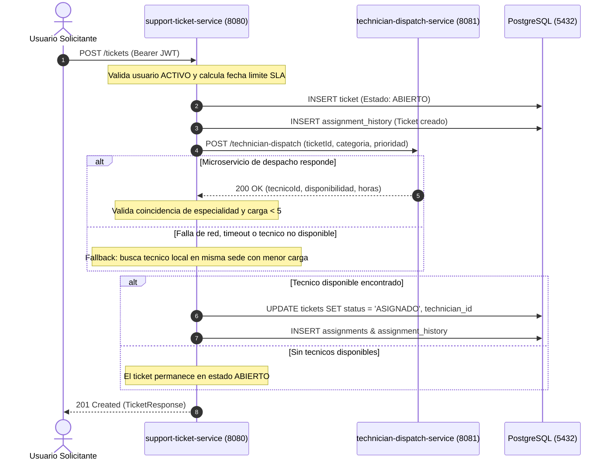

**Reglas de Asignacion:**
1. Capacidad maxima: Ningun tecnico puede superar 5 tickets activos simultaneos (estados `ASIGNADO` o `EN_PROGRESO`).
2. Afinidad de especialidad: La especialidad del tecnico debe coincidir con la categoria de la incidencia (`HARDWARE`, `SOFTWARE`, `RED`, `ACCESOS`, `OTRO`).
3. Respaldo por contingencia (Fallback): Si el microservicio externo falla o retorna un tecnico sobrecargado, el servicio central busca un tecnico activo de la misma sede con la menor carga actual.

---

### 3.3. Ciclo de Vida y Transiciones de Estado del Ticket

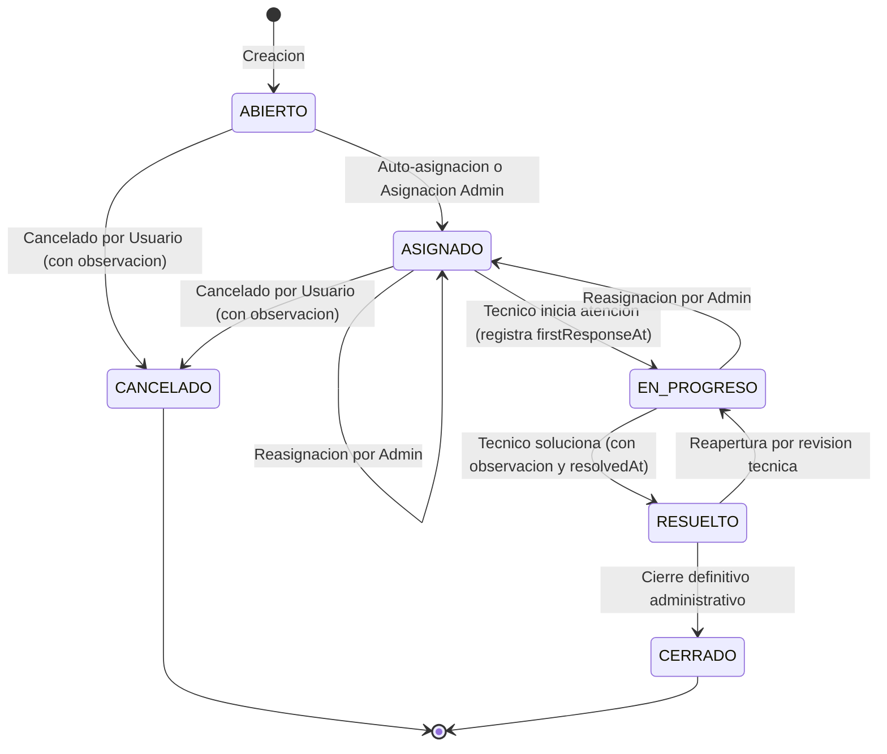

**Reglas de Transicion:**
* Toda cancelacion o resolucion exige obligatoriamente un texto de observacion descriptivo (validado a traves del validador de Bean Validation `@ValidStatusChange`).
* Pasar a `EN_PROGRESO` estampa automaticamente la marca de tiempo `firstResponseAt`.
* Pasar a `RESUELTO` estampa la marca de tiempo `resolvedAt` para computar metricas de tiempo de resolucion.

---

### 3.4. Reglas de SLA y Escalamiento Automatico

**Horas limite de resolucion iniciales (semillero V3):**
* `CRITICA`: 4 horas.
* `ALTA`: 8 horas.
* `MEDIA`: 24 horas.
* `BAJA`: 72 horas.

**Reglas del Scheduler de Escalamiento (`TicketEscalationScheduler`):**
* Un proceso periodico en segundo plano evalua los tickets activos cada 60 segundos.
* Si la hora actual supera el `slaDeadline`, el ticket incrementa su contador `escalationCount`, se escala su prioridad al siguiente nivel mas urgente (`BAJA` -> `MEDIA` -> `ALTA` -> `CRITICA`), se registra una entrada en `assignment_history` y se marca para no volver a escalar si ya llego al tope.

---

## 4. Instrucciones de Ejecucion

### 4.1. Despliegue con Docker Compose (Recomendado)

**Paso 1: Configurar variables de entorno**
```powershell
# En Windows PowerShell:
copy .env.example .env

# En Linux o MacOS:
cp .env.example .env
```

**Paso 2: Compilar y levantar contenedores**
```bash
docker compose up --build -d
```

Este comando compila y levanta la red completa:
1. `helpflow-db`: PostgreSQL 16 expuesto en el puerto `5432`.
2. `technician-dispatch-service`: Microservicio en el puerto `8081` con healthcheck activo.
3. `support-ticket-service`: Microservicio central en el puerto `8080` con healthcheck activo.

Para detener el entorno conservando los datos:
```bash
docker compose down
```

Para reiniciar con la base de datos limpia desde cero:
```bash
docker compose down -v
docker compose up --build -d
```

---

### 4.2. Ejecucion Local en Desarrollo

**Prerrequisitos:**
* JDK 21 (Eclipse Temurin recomendado).
* PostgreSQL 16 activo con base de datos `helpflow_tickets` (o el contenedor `helpflow-db`).

**Paso 1: Iniciar technician-dispatch-service:**
```powershell
cd technician-dispatch-service
$env:JAVA_HOME = "C:\Program Files\Eclipse Adoptium\jdk-21.0.12.8-hotspot"
.\mvnw.cmd spring-boot:run
```

**Paso 2: Iniciar support-ticket-service:**
```powershell
cd ..\support-ticket-service
$env:JAVA_HOME = "C:\Program Files\Eclipse Adoptium\jdk-21.0.12.8-hotspot"
.\mvnw.cmd spring-boot:run
```

---

## 5. Credenciales de Prueba Pre-cargadas

Todos los usuarios cargados por la migracion Flyway `V3__datos_iniciales.sql` tienen la contrasena: **`admin123`**

| Rol | Correo Electronico | Documento / Codigo | Especialidad / Sede | Carga Max. |
| :--- | :--- | :--- | :--- | :---: |
| Administrador | `admin@helpflow.com` | `DOC-ADMIN-01` | Sede Central | N/A |
| Tecnico Hardware | `tec01@helpflow.com` | `TEC-001` | HARDWARE / Sede Central | 5 |
| Tecnico Hardware | `tec02@helpflow.com` | `TEC-002` | HARDWARE / Sede Norte | 5 |
| Tecnico Software | `tec05@helpflow.com` | `TEC-005` | SOFTWARE / Sede Central | 5 |
| Tecnico Redes | `tec09@helpflow.com` | `TEC-009` | RED / Sede Central | 5 |
| Tecnico Accesos | `tec13@helpflow.com` | `TEC-013` | ACCESOS / Sede Central | 5 |
| Tecnico General | `tec17@helpflow.com` | `TEC-017` | OTRO / Sede Central | 5 |

*(Existen en total 20 tecnicos cargados de `TEC-001` a `TEC-020` distribuidos en sedes Central, Norte, Sur y Occidente).*

---

## 6. Evidencias de Pruebas Automatizadas

### 6.1. Suite de Pruebas Unitarias e Integracion (`support-ticket-service`)
Ejecucion completa con base de datos real bajo Testcontainers (`postgres:16-alpine`), validaciones cruzadas, seguridad y flujo E2E:

```text
[INFO] -------------------------------------------------------
[INFO]  T E S T S
[INFO] -------------------------------------------------------
[INFO] Running com.helpflow.tickets.application.usecase.CreateTicketServiceTest
[INFO] Tests run: 1, Failures: 0, Errors: 0, Skipped: 0, Time elapsed: 1.832 s
[INFO] Running com.helpflow.tickets.application.usecase.AssignTicketServiceTest
[INFO] Tests run: 4, Failures: 0, Errors: 0, Skipped: 0, Time elapsed: 0.160 s
[INFO] Running com.helpflow.tickets.application.usecase.ManageTicketServiceTest
[INFO] Tests run: 4, Failures: 0, Errors: 0, Skipped: 0, Time elapsed: 0.081 s
[INFO] Running com.helpflow.tickets.application.usecase.EscalateTicketsServiceTest
[INFO] Tests run: 6, Failures: 0, Errors: 0, Skipped: 0, Time elapsed: 0.095 s
[INFO] Running com.helpflow.tickets.infrastructure.adapter.out.security.BCryptPasswordEncoderAdapterTest
[INFO] Tests run: 1, Failures: 0, Errors: 0, Skipped: 0, Time elapsed: 0.038 s
[INFO] Running com.helpflow.tickets.integration.TicketFlowIntegrationTest
[INFO] Tests run: 11, Failures: 0, Errors: 0, Skipped: 0, Time elapsed: 24.31 s
[INFO] Running com.helpflow.tickets.SupportTicketServiceApplicationTests
[INFO] Tests run: 1, Failures: 0, Errors: 0, Skipped: 0, Time elapsed: 4.847 s
[INFO] 
[INFO] Results:
[INFO] 
[INFO] Tests run: 28, Failures: 0, Errors: 0, Skipped: 0
[INFO] 
[INFO] ------------------------------------------------------------------------
[INFO] BUILD SUCCESS
[INFO] Total time:  45.393 s
[INFO] ------------------------------------------------------------------------
```

### 6.2. Pruebas de Despacho (`technician-dispatch-service`)
```text
[INFO] Running com.helpflow.dispatch.DispatchControllerTest
[INFO] Tests run: 3, Failures: 0, Errors: 0, Skipped: 0
[INFO] BUILD SUCCESS
```

---

## 7. Evidencia de Metricas, Tickets Vencidos, Seguridad y Logs

### 7.1. Registro de Logs con Patron MDC `[traceId=...]`
Cada peticion entrante genera un identificador unico de trazabilidad propagado en los registros del servidor:

```text
2026-10-27T22:07:44.427Z INFO  [traceId=] 1 --- [support-ticket-service] [nio-8080-exec-1] o.s.web.servlet.DispatcherServlet : Completed initialization in 2 ms
2026-10-28T00:42:22.735Z WARN  [traceId=3eac2d56-f525-4ece-944e-c81b65e0fb98] 1 --- [support-ticket-service] [nio-8080-exec-3] c.h.t.i.a.i.r.e.GlobalExceptionHandler : Fallo de autenticacion: Credenciales invalidas
2026-10-28T00:42:50.618Z WARN  [traceId=e302b19f-7571-404b-97a9-702715b35005] 1 --- [support-ticket-service] [nio-8080-exec-6] c.h.t.i.a.i.r.e.GlobalExceptionHandler : Acceso denegado: Access Denied
```

### 7.2. Evidencia de Errores de Seguridad en RFC 7807 (401 y 403)
**Error 401 Unauthorized (`/auth/login` con clave incorrecta):**
```json
{
  "detail": "Credenciales invalidas",
  "instance": "/auth/login",
  "status": 401,
  "title": "No autorizado",
  "type": "https://helpflow.com/errors/unauthorized",
  "timestamp": "2026-10-28T00:42:22.735000823Z",
  "traceId": "3eac2d56-f525-4ece-944e-c81b65e0fb98"
}
```

**Error 403 Forbidden (`POST /admin/users` intentado por usuario normal):**
```json
{
  "detail": "Access Denied",
  "instance": "/admin/users",
  "status": 403,
  "title": "Acceso denegado",
  "type": "https://helpflow.com/errors/access-denied",
  "timestamp": "2026-10-28T00:42:50.618516047Z",
  "traceId": "e302b19f-7571-404b-97a9-702715b35005"
}
```

### 7.3. Metricas de Seguridad en Actuator
```bash
# Contador de intentos fallidos de autenticacion (401)
curl http://localhost:8080/actuator/metrics/helpflow.security.auth_failures
```
```json
{
  "name": "helpflow.security.auth_failures",
  "description": "Numero de fallos de autenticacion",
  "measurements": [
    {
      "statistic": "COUNT",
      "value": 2.0
    }
  ]
}
```

```bash
# Contador de accesos denegados por permisos (403)
curl http://localhost:8080/actuator/metrics/helpflow.security.access_denied
```
```json
{
  "name": "helpflow.security.access_denied",
  "description": "Numero de accesos denegados a tickets o recursos",
  "measurements": [
    {
      "statistic": "COUNT",
      "value": 1.0
    }
  ]
}
```

### 7.4. Metrica de Tickets Vencidos en Tiempo Real (`helpflow.tickets.overdue`)
```json
{
  "name": "helpflow.tickets.overdue",
  "description": "Numero de tickets con SLA vencido en tiempo real",
  "measurements": [
    {
      "statistic": "VALUE",
      "value": 0.0
    }
  ],
  "availableTags": []
}
```

### 7.5. Metricas Ingeribles por Prometheus (`/actuator/prometheus`)
```text
# HELP helpflow_tickets_overdue Numero de tickets con SLA vencido en tiempo real
# TYPE helpflow_tickets_overdue gauge
helpflow_tickets_overdue 0.0
# HELP helpflow_security_auth_failures_total Numero de fallos de autenticacion
# TYPE helpflow_security_auth_failures_total counter
helpflow_security_auth_failures_total 2.0
# HELP helpflow_security_access_denied_total Numero de accesos denegados a tickets o recursos
# TYPE helpflow_security_access_denied_total counter
helpflow_security_access_denied_total 1.0
```

---

## 8. Capturas de Pruebas en Postman

A continuacion se presentan las evidencias graficas de las pruebas realizadas sobre los endpoints del sistema HelpFlow:

### 8.1. Autenticacion y Gestion de Usuarios
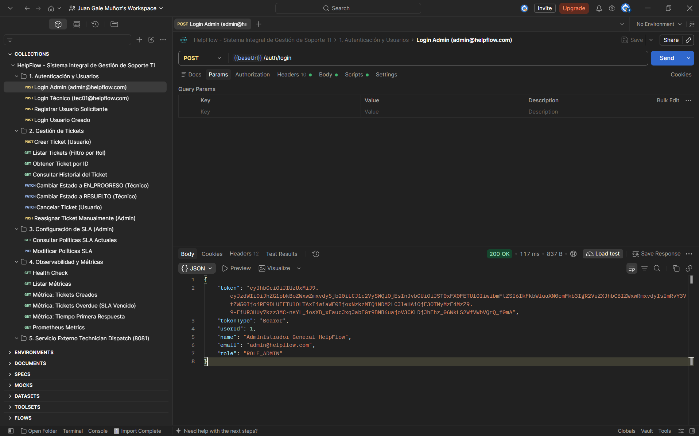
*Figura 1: Autenticacion del Administrador (`POST /auth/login`), retorno de token JWT y almacenamiento automatico.*

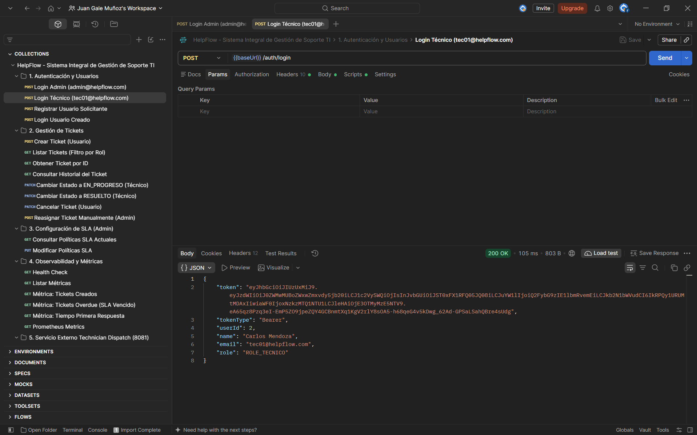
*Figura 2: Autenticacion de Tecnico (`POST /auth/login`) con rol `ROLE_TECNICO`.*

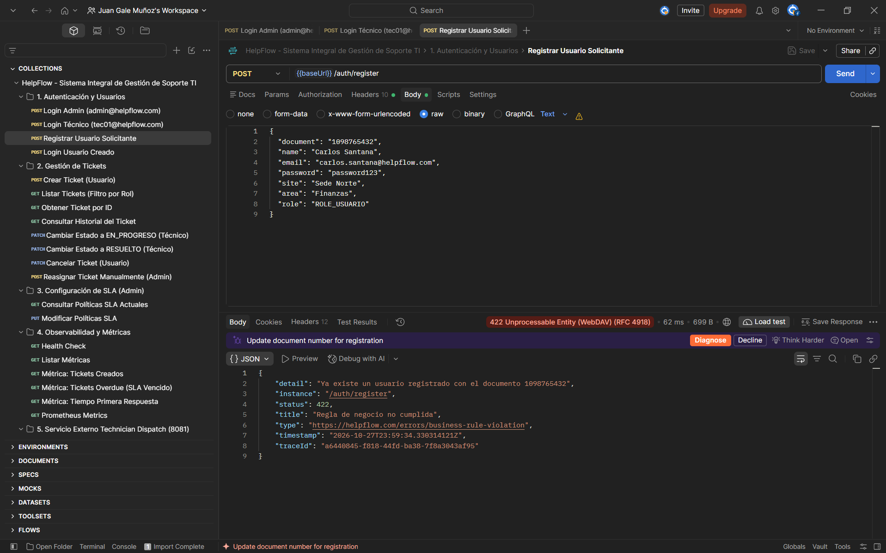
*Figura 3: Registro de usuario solicitante (`POST /auth/register`).*

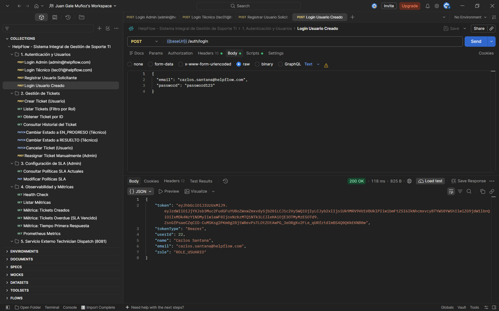
*Figura 4: Inicio de sesion del usuario recien registrado.*

---

### 8.2. Gestion y Ciclo de Vida de Tickets
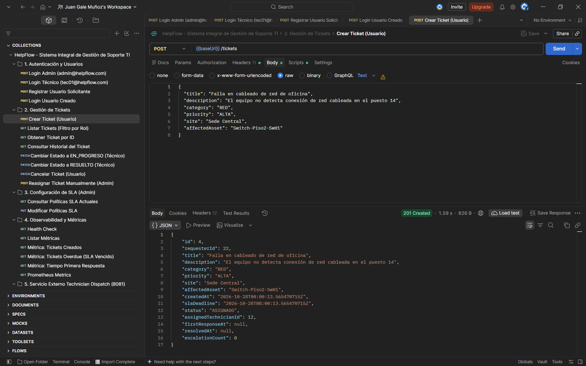
*Figura 5: Creacion de ticket (`POST /tickets`) con asignacion tecnica automatica inmediata en estado `ASIGNADO`.*

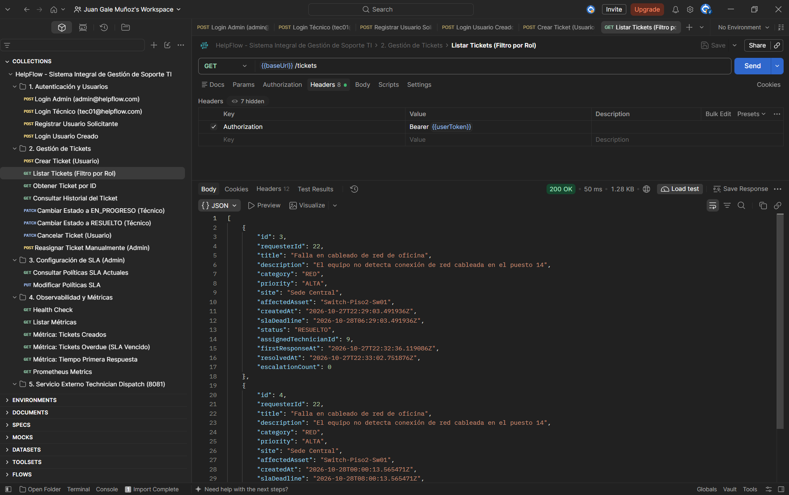
*Figura 6: Consulta de tickets (`GET /tickets`) filtrada por autorizacion segun el rol del usuario autenticado.*

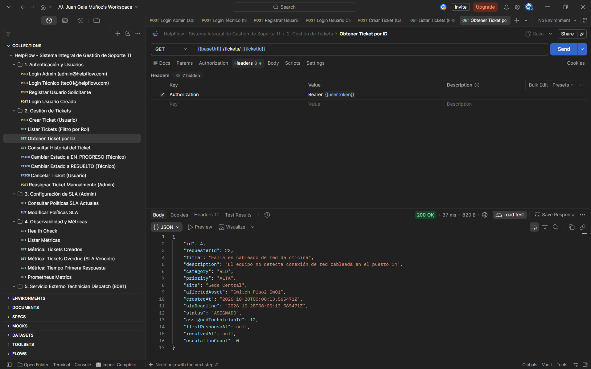
*Figura 7: Detalle completo del ticket (`GET /tickets/{id}`).*

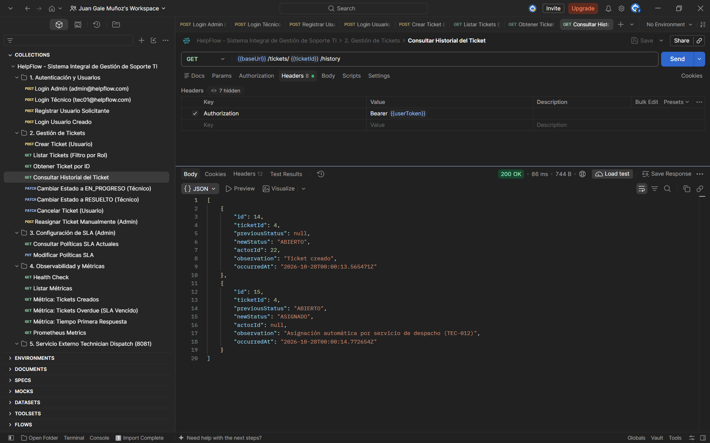
*Figura 8: Auditoria cronologica completa del ticket (`GET /tickets/{id}/history`).*

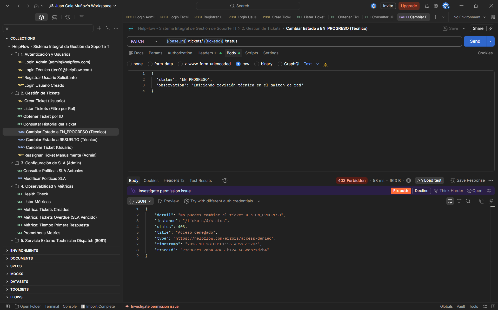
*Figura 9: Transicion de estado a `EN_PROGRESO` (`PATCH /tickets/{id}/status`), registrando `firstResponseAt`.*

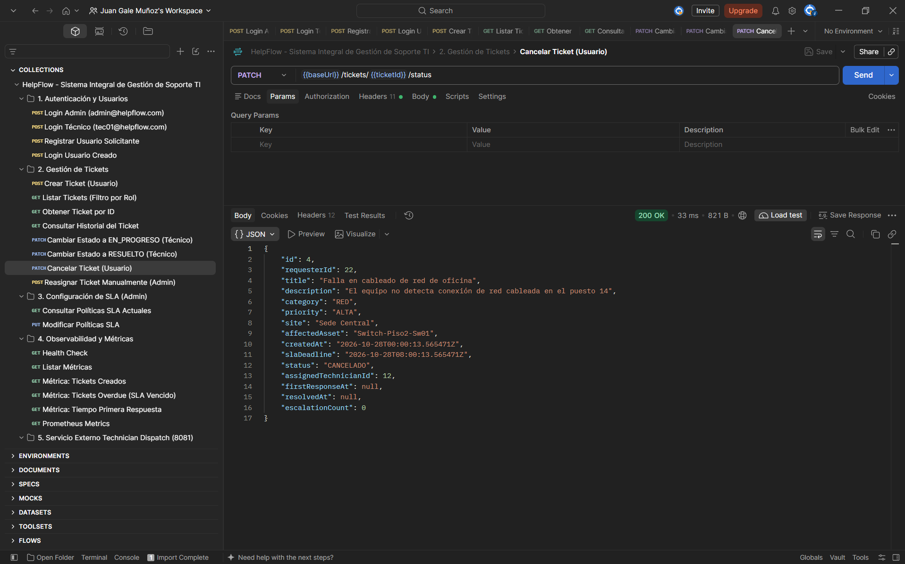
*Figura 10: Resolucion del ticket (`PATCH /tickets/{id}/status`), validando observacion obligatoria y `resolvedAt`.*

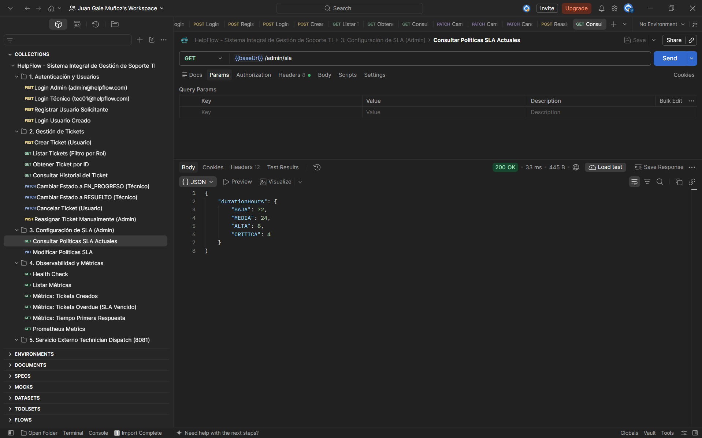
*Figura 11: Cancelacion de ticket por parte del usuario solicitante con motivo.*

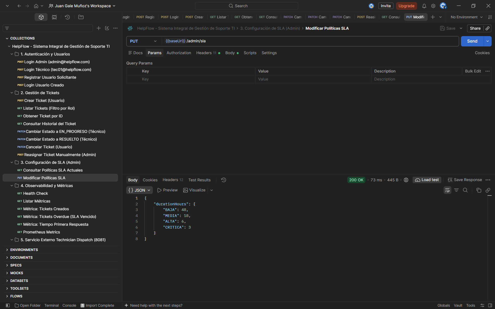
*Figura 12: Reasignacion manual de tecnico por parte del administrador (`POST /tickets/{id}/assign`).*

---

### 8.3. Configuracion de SLA, Despacho y Observabilidad
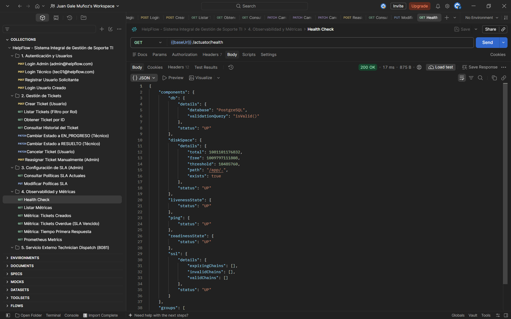
*Figura 13: Consulta de politicas activas de SLA (`GET /admin/sla`).*

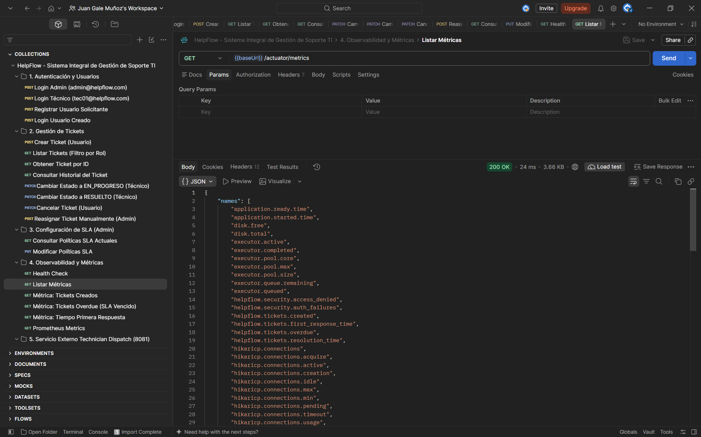
*Figura 14: Actualizacion administrativa de tiempos de SLA (`PUT /admin/sla`).*

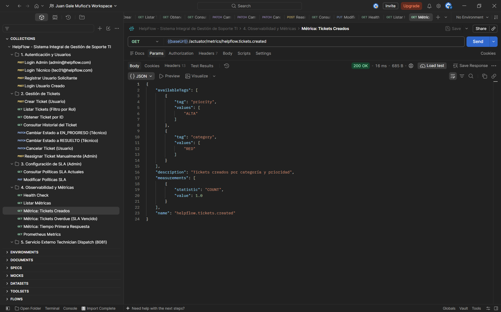
*Figura 15: Verificacion de salud de servicios y conexion a base de datos (`GET /actuator/health`).*

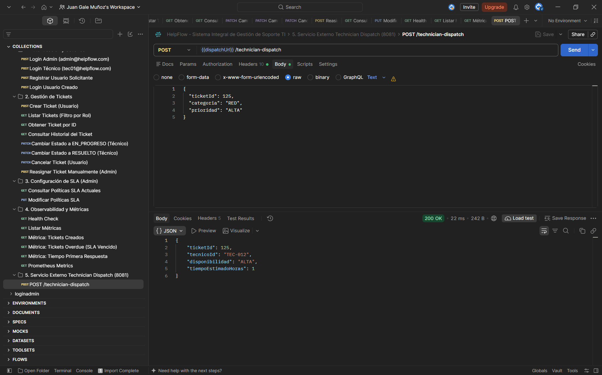
*Figura 16: Peticion directa al microservicio externo determinista de asignacion (`POST /technician-dispatch`).*

---

## 9. Recursos Adicionales

* **Coleccion Postman:** Se incluye el archivo [HelpFlow.postman_collection.json](HelpFlow.postman_collection.json) en la raiz del proyecto con el flujo completo de pruebas y variables preconfiguradas.
* **Swagger UI:** Accesible en [http://localhost:8080/swagger-ui/index.html](http://localhost:8080/swagger-ui/index.html) (boton **Authorize** para ingresar el token JWT Bearer).
* **Documento de Evidencias:** Archivo original `Pruebas Postman Proyecto HelpFlow.docx`.
