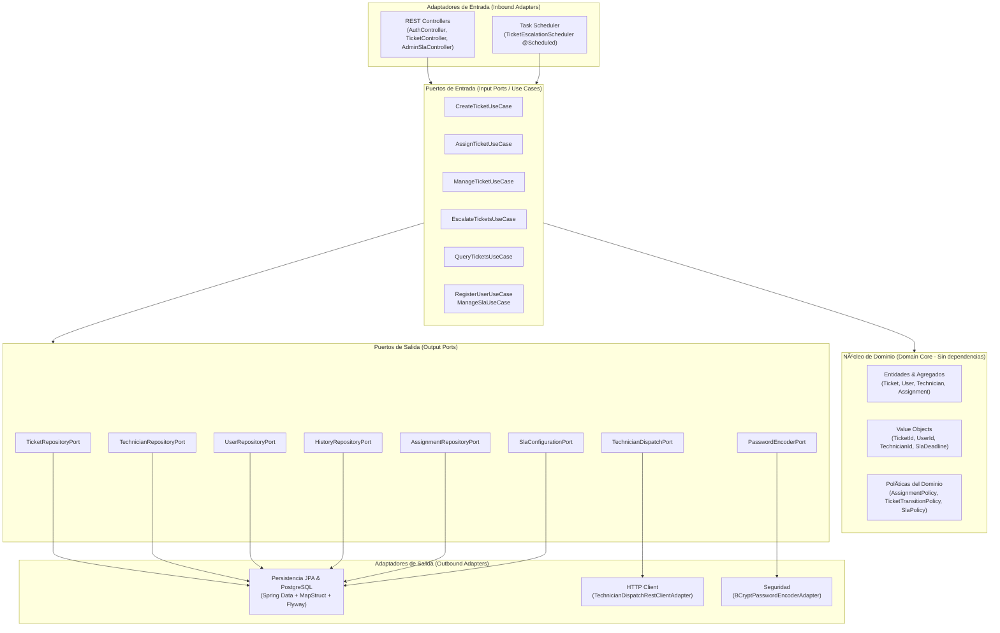
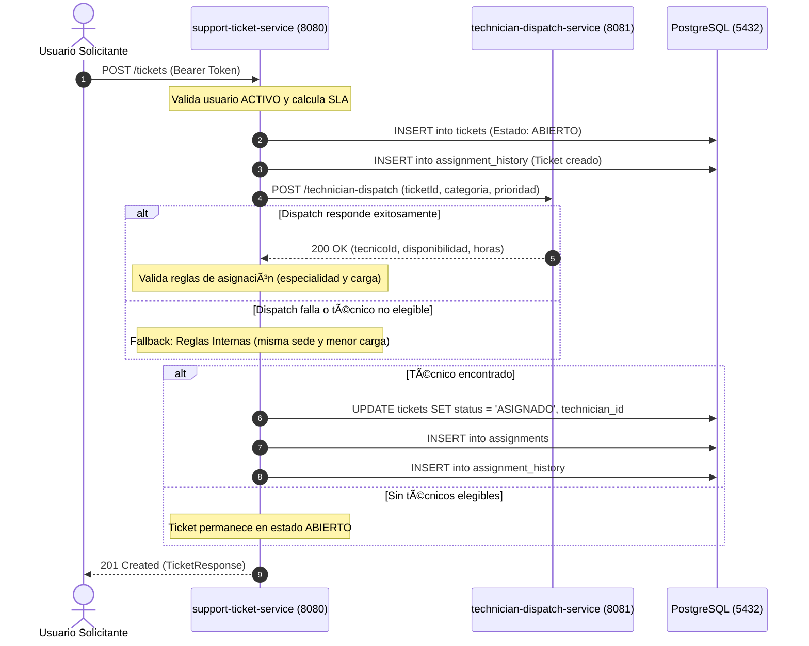
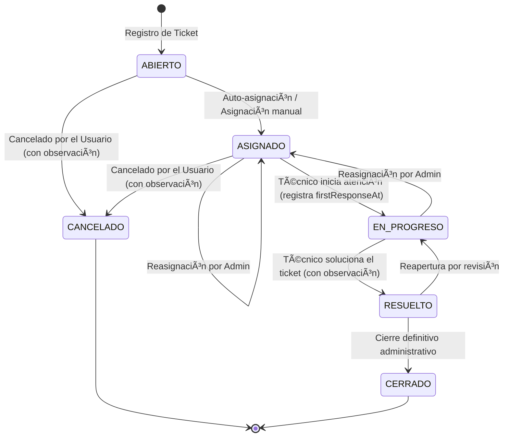

# HelpFlow - Sistema Integral de Gestión de Soporte TI

[](https://adoptium.net/)
[](https://spring.io/projects/spring-boot)
[]()
[](https://www.postgresql.org/)
[](https://www.docker.com/)

**HelpFlow** es una plataforma corporativa para el registro, priorización, asignación determinista, escalamiento por SLA y cierre de incidencias tecnológicas en entornos distribuidos multi-sede.

El sistema se compone de dos microservicios desacoplados:
1. **`support-ticket-service` (Puerto 8080):** Servicio central construido bajo arquitectura hexagonal pura, con persistencia JPA avanzada en PostgreSQL, migraciones Flyway, seguridad stateless mediante JWT, auditoría transaccional, observabilidad con Micrometer/Prometheus y manejo estandarizado de errores RFC 7807 (`ProblemDetail`).
2. **`technician-dispatch-service` (Puerto 8081):** Microservicio externo simulado y determinista que evalúa la categoría, prioridad y ticket para sugerir técnicos y disponibilidad estimada.

---

## 1. Diagramas del Sistema

### 1.1. Arquitectura Hexagonal (`support-ticket-service`)



---

### 1.2. Relación e Interacción entre Microservicios



---

### 1.3. Ciclo de Vida y Transiciones de Estado del Ticket



---

## 2. Roles y Control de Acceso (Matriz RBAC)

| Funcionalidad | `ROLE_USUARIO` | `ROLE_TECNICO` | `ROLE_ADMIN` |
| :--- | :---: | :---: | :---: |
| Crear tickets |  Sí | ❌ No |  Sí |
| Consultar tickets |  Solo propios |  Solo asignados |  Todos |
| Cancelar ticket propio |  Sí (con motivo) | ❌ No |  Sí |
| Avanzar a `EN_PROGRESO` | ❌ No |  Solo asignados |  Sí |
| Resolver ticket | ❌ No |  Solo asignados |  Sí |
| Reasignar técnico | ❌ No | ❌ No |  Sí |
| Configurar horas de SLA | ❌ No | ❌ No |  Sí |

---

## 3. Credenciales de Prueba Pre-cargadas (Flyway V3)

Todos los usuarios tienen la contraseña: **`admin123`**

| Rol | Correo Electrónico | Especialidad / Sede | Carga Máx. |
| :--- | :--- | :--- | :---: |
| **Administrador** | `admin@helpflow.com` | Dirección TI / Sede Central | N/A |
| **Técnico (Hardware)** | `tec01@helpflow.com` (`TEC-001`) | HARDWARE / Sede Central | 5 |
| **Técnico (Hardware)** | `tec02@helpflow.com` (`TEC-002`) | HARDWARE / Sede Norte | 5 |
| **Técnico (Software)** | `tec05@helpflow.com` (`TEC-005`) | SOFTWARE / Sede Central | 5 |
| **Técnico (Red)** | `tec09@helpflow.com` (`TEC-009`) | RED / Sede Central | 5 |
| **Técnico (Accesos)** | `tec13@helpflow.com` (`TEC-013`) | ACCESOS / Sede Central | 5 |
| **Técnico (General)** | `tec17@helpflow.com` (`TEC-017`) | OTRO / Sede Central | 5 |

*(Nota: Existen en total 20 técnicos registrados de `TEC-001` a `TEC-020` distribuidos entre las 5 especialidades y 4 sedes).*

---

## 4. Endpoints Principales de la API

### Autenticación (`/auth`)
* `POST /auth/register`: Registro de nuevos usuarios y técnicos con documento y correo únicos.
* `POST /auth/login`: Autenticación con credenciales que retorna el token JWT Bearer.

### Tickets de Soporte (`/tickets`)
* `POST /tickets`: Creación de ticket con auto-asignación inmediata.
* `GET /tickets`: Listado de tickets filtrado según el rol del actor autenticado.
* `GET /tickets/{id}`: Detalle del ticket con validación de propiedad.
* `GET /tickets/{id}/history`: Historial completo de cambios y observaciones.
* `PATCH /tickets/{id}/status`: Transición de estado (`status` y `observation`).
* `POST /tickets/{id}/assign`: Reasignación manual por administrador.

### Administración de SLA (`/admin/sla`)
* `GET /admin/sla`: Consulta de las horas límites de SLA activas por prioridad.
* `PUT /admin/sla`: Modificación de horas límites de SLA por el administrador.

### Observabilidad y Monitoreo (`/actuator`)
* `GET /actuator/health`: Estado de salud de la aplicación y la conexión a base de datos.
* `GET /actuator/metrics`: Listado de métricas disponibles.
* `GET /actuator/metrics/helpflow.tickets.created`: Contador de tickets por categoría y prioridad.
* `GET /actuator/metrics/helpflow.tickets.overdue`: Gauge en tiempo real de tickets con SLA vencido.
* `GET /actuator/metrics/helpflow.tickets.first_response_time`: Tiempo medio de primera respuesta.
* `GET /actuator/metrics/helpflow.tickets.resolution_time`: Tiempo medio de resolución.
* `GET /actuator/prometheus`: Exportador para scraping de Prometheus.

---

## 5. Instrucciones de Ejecución

### Opción A: Despliegue Completo con Docker Compose (Recomendado)

En la raíz del proyecto, ejecuta un único comando:

```bash
docker compose up --build -d
```

Esto levantará automáticamente en orden:
1. `helpflow-db`: PostgreSQL 16 en el puerto `5432`.
2. `technician-dispatch-service`: Microservicio en el puerto `8081`.
3. `support-ticket-service`: Microservicio central en el puerto `8080`.

Para detener los servicios:
```bash
docker compose down
```

---

### Opción B: Ejecución Local en Desarrollo

1. **Asegurar PostgreSQL local** en el puerto `5432` con base de datos `helpflow_tickets` (o usar la BD levantada por docker).
2. **Iniciar `technician-dispatch-service`:**
   ```powershell
   cd technician-dispatch-service
   $env:JAVA_HOME = "C:\Program Files\Eclipse Adoptium\jdk-21.0.12.8-hotspot"
   .\mvnw.cmd spring-boot:run
   ```
3. **Iniciar `support-ticket-service`:**
   ```powershell
   cd support-ticket-service
   $env:JAVA_HOME = "C:\Program Files\Eclipse Adoptium\jdk-21.0.12.8-hotspot"
   .\mvnw.cmd spring-boot:run
   ```

---

## 6. Documentación Swagger y Colección Postman

* **Swagger UI Interactivo:**
  Accede desde tu navegador a:
  [http://localhost:8080/swagger-ui/index.html](http://localhost:8080/swagger-ui/index.html)
  *(Permite ingresar el token JWT en el botón **Authorize** para probar todos los endpoints protegidos).*

* **Colección Postman:**
  Importa el archivo [`HelpFlow.postman_collection.json`](file:///C:/Users/juang/OneDrive/Documentos/riwi-proyects/HelpFlow/HelpFlow.postman_collection.json) ubicado en la raíz del proyecto. Viene preconfigurado con tests automáticos para capturar y propagar los tokens JWT en cada petición.

---

## 7. Ejecución de Pruebas Automatizadas

Para validar toda la suite de pruebas unitarias de casos de uso y de controladores:

```powershell
# En support-ticket-service:
cd support-ticket-service
$env:JAVA_HOME = "C:\Program Files\Eclipse Adoptium\jdk-21.0.12.8-hotspot"
.\mvnw.cmd test -Dtest="*ServiceTest"

# En technician-dispatch-service:
cd ..\technician-dispatch-service
.\mvnw.cmd test
```
