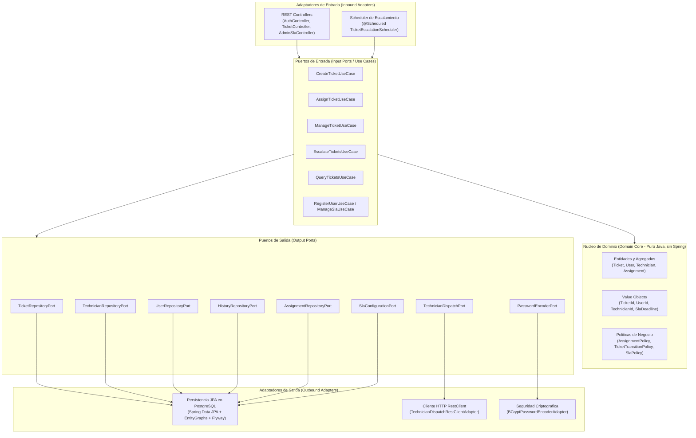
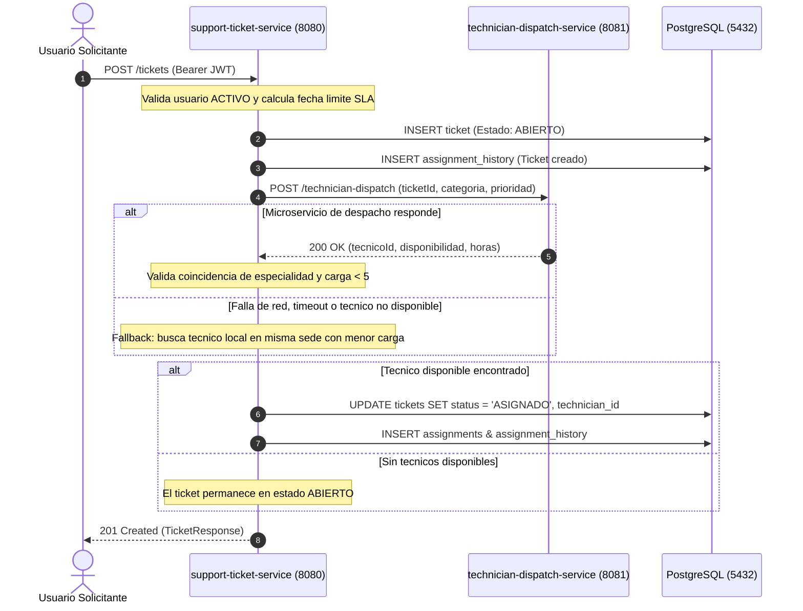
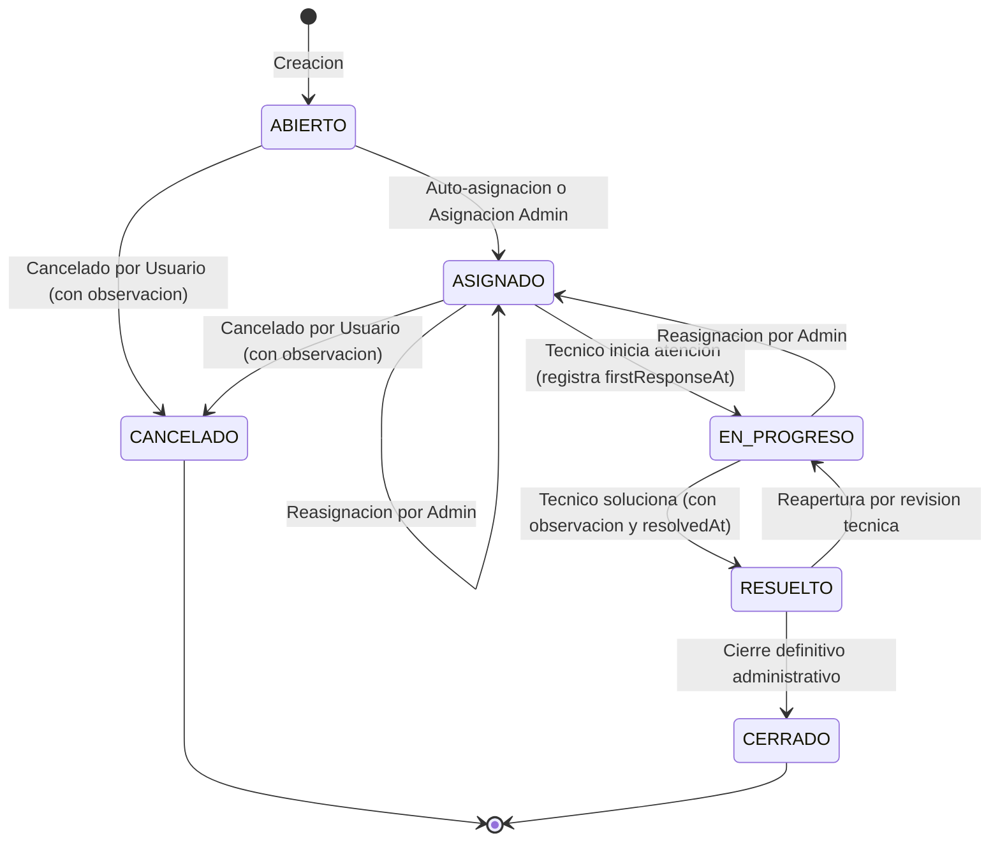

# HelpFlow - Sistema Integral de Gestion de Soporte TI

[](https://adoptium.net/)
[](https://spring.io/projects/spring-boot)
[-blue.svg)]()
[](https://www.postgresql.org/)
[](https://www.docker.com/)

HelpFlow es una solucion empresarial para el registro, priorizacion, asignacion tecnica inteligente, control de acuerdos de nivel de servicio (SLA) y resolucion de incidentes tecnologicos en organizaciones multi-sede.

El sistema se estructura mediante dos microservicios desacoplados:
* **support-ticket-service (Puerto 8080):** Servicio central implementado bajo arquitectura hexagonal estricta (Ports and Adapters). Contiene el modelo de dominio puro, persistencia relacional optimizada con JPA en PostgreSQL, migraciones de base de datos automatizadas con Flyway, autenticacion stateless con JWT, manejo de errores estandarizado RFC 7807 (ProblemDetail) y observabilidad integral con Micrometer y Prometheus.
* **technician-dispatch-service (Puerto 8081):** Microservicio simulado y determinista que procesa la categoria, prioridad e identificador del ticket para sugerir el tecnico optimo y su disponibilidad estimada.

---

## 1. Diagrama de Arquitectura Hexagonal

El diseno del servicio central asegura un desacoplamiento total: el nucleo de dominio no posee dependencias de frameworks ni de infraestructura externa.



---

## 2. Catalogo de Endpoints

### 2.1. Autenticacion y Usuarios (`/auth`)
| Metodo | Ruta | Descripcion | Acceso |
| :--- | :--- | :--- | :--- |
| `POST` | `/auth/register` | Registro de nuevos usuarios y tecnicos | Publico / Admin |
| `POST` | `/auth/login` | Autenticacion que genera token Bearer JWT | Publico |

### 2.2. Gestion de Tickets (`/tickets`)
| Metodo | Ruta | Descripcion | Acceso |
| :--- | :--- | :--- | :--- |
| `POST` | `/tickets` | Creacion y auto-asignacion inmediata de ticket | Usuario / Admin |
| `GET` | `/tickets` | Listado paginado segun rol del usuario | Autenticado |
| `GET` | `/tickets/{id}` | Consulta detallada del ticket con validacion de autorizacion | Autenticado |
| `GET` | `/tickets/{id}/history` | Historial cronologico de asignaciones y estados | Autenticado |
| `PATCH` | `/tickets/{id}/status` | Transicion de estado (`status`, `observation`) | Tecnico / Admin / Creador |
| `POST` | `/tickets/{id}/assign` | Reasignacion manual de tecnico | Solo Admin |

### 2.3. Politicas de SLA (`/admin/sla`)
| Metodo | Ruta | Descripcion | Acceso |
| :--- | :--- | :--- | :--- |
| `GET` | `/admin/sla` | Lista de horas limite configuradas por prioridad | Solo Admin |
| `PUT` | `/admin/sla` | Actualizacion del tiempo maximo de resolucion SLA | Solo Admin |

### 2.4. Microservicio de Despacho Tecnico (Puerto 8081)
| Metodo | Ruta | Descripcion | Acceso |
| :--- | :--- | :--- | :--- |
| `POST` | `/technician-dispatch` | Estimacion determinista de tecnico y tiempo | Interno / Publico |

### 2.5. Actuator y Monitoreo (Ambos servicios)
| Metodo | Ruta | Descripcion |
| :--- | :--- | :--- |
| `GET` | `/actuator/health` | Estado de salud (db, liveness, readiness) |
| `GET` | `/actuator/metrics` | Catalogo de metricas registradas |
| `GET` | `/actuator/metrics/helpflow.tickets.overdue` | Medicion en tiempo real de tickets vencidos |
| `GET` | `/actuator/prometheus` | Exportador para ingestion en Prometheus |

---

## 3. Roles, Flujo de Asignacion, Transiciones y Reglas de SLA

### 3.1. Matriz de Control de Acceso (RBAC)
| Accion | ROLE_USUARIO | ROLE_TECNICO | ROLE_ADMIN |
| :--- | :---: | :---: | :---: |
| Crear ticket | Si | No | Si |
| Consultar tickets | Solo los propios | Solo los asignados | Todos |
| Cancelar ticket | Si (con motivo) | No | Si |
| Avanzar a EN_PROGRESO | No | Solo los asignados | Si |
| Resolver ticket | No | Solo los asignados | Si |
| Reasignar tecnico | No | No | Si |
| Gestionar politicas SLA | No | No | Si |
| Registrar usuarios/tecnicos | No | No | Si |

---

### 3.2. Flujo de Asignacion Inteligente y Fallback



**Reglas de Asignacion:**
1. Capacidad maxima: Ningun tecnico puede superar 5 tickets activos simultaneos (estados `ASIGNADO` o `EN_PROGRESO`).
2. Afinidad de especialidad: La especialidad del tecnico debe coincidir con la categoria de la incidencia (`HARDWARE`, `SOFTWARE`, `RED`, `ACCESOS`, `OTRO`).
3. Respaldo por contingencia (Fallback): Si el microservicio externo falla o retorna un tecnico sobrecargado, el servicio central busca un tecnico activo de la misma sede con la menor carga actual.

---

### 3.3. Ciclo de Vida y Transiciones de Estado del Ticket



**Reglas de Transicion:**
* Toda cancelacion o resolucion exige obligatoriamente un texto de observacion descriptivo.
* Pasar a `EN_PROGRESO` estampa automaticamente la marca de tiempo `firstResponseAt`.
* Pasar a `RESUELTO` estampa la marca de tiempo `resolvedAt` para computar metricas de tiempo de resolucion.

---

### 3.4. Reglas de SLA y Escalamiento Automatico

**Horas limite de resolucion iniciales (semillero V3):**
* `CRITICA`: 4 horas.
* `ALTA`: 8 horas.
* `MEDIA`: 24 horas.
* `BAJA`: 72 horas.

**Reglas del Scheduler de Escalamiento:**
* Un proceso periodico en segundo plano (`TicketEscalationScheduler`) evalua los tickets activos cada 60 segundos.
* Si la hora actual supera el `slaDeadline`, el ticket incrementa su contador `escalationCount`, se extiende su plazo en +24 horas y se genera un registro en `assignment_history` para auditoria.

---

## 4. Instrucciones de Ejecucion

### 4.1. Despliegue con Docker Compose (Recomendado)

En la raiz del proyecto:
```bash
docker compose up --build -d
```

Este comando compila y levanta la red completa:
1. `helpflow-db`: PostgreSQL 16 expuesto en el puerto `5432`.
2. `technician-dispatch-service`: Microservicio en el puerto `8081` con healthcheck activo.
3. `support-ticket-service`: Microservicio central en el puerto `8080` con healthcheck activo.

Para detener el entorno conservando los datos:
```bash
docker compose down
```

Para reiniciar con la base de datos limpia:
```bash
docker compose down -v
docker compose up --build -d
```

---

### 4.2. Ejecucion Local en Desarrollo

**Prerrequisitos:**
* JDK 21 (Eclipse Temurin recomendado).
* PostgreSQL 16 activo con base de datos `helpflow_tickets` (o el contenedor `helpflow-db`).

**Paso 1: Iniciar technician-dispatch-service:**
```powershell
cd technician-dispatch-service
$env:JAVA_HOME = "C:\Program Files\Eclipse Adoptium\jdk-21.0.12.8-hotspot"
.\mvnw.cmd spring-boot:run
```

**Paso 2: Iniciar support-ticket-service:**
```powershell
cd ..\support-ticket-service
$env:JAVA_HOME = "C:\Program Files\Eclipse Adoptium\jdk-21.0.12.8-hotspot"
.\mvnw.cmd spring-boot:run
```

---

## 5. Credenciales de Prueba Pre-cargadas

Todos los usuarios cargados por la migracion Flyway `V3__datos_iniciales.sql` tienen la contrasena: **`admin123`**

| Rol | Correo Electronico | Documento / Codigo | Especialidad / Sede | Carga Max. |
| :--- | :--- | :--- | :--- | :---: |
| Administrador | `admin@helpflow.com` | `DOC-ADMIN-01` | Sede Central | N/A |
| Tecnico Hardware | `tec01@helpflow.com` | `TEC-001` | HARDWARE / Sede Central | 5 |
| Tecnico Hardware | `tec02@helpflow.com` | `TEC-002` | HARDWARE / Sede Norte | 5 |
| Tecnico Software | `tec05@helpflow.com` | `TEC-005` | SOFTWARE / Sede Central | 5 |
| Tecnico Redes | `tec09@helpflow.com` | `TEC-009` | RED / Sede Central | 5 |
| Tecnico Accesos | `tec13@helpflow.com` | `TEC-013` | ACCESOS / Sede Central | 5 |
| Tecnico General | `tec17@helpflow.com` | `TEC-017` | OTRO / Sede Central | 5 |

*(Existen en total 20 tecnicos cargados de `TEC-001` a `TEC-020` distribuidos en sedes Central, Norte, Sur y Occidente).*

---

## 6. Evidencias de Pruebas Automatizadas

### 6.1. Suite de Pruebas Unitarias e Integracion (`support-ticket-service`)
Ejecucion completa de casos de uso (Create, Assign, Manage, Escalate, Security, Spring Context):

```text
[INFO] -------------------------------------------------------
[INFO]  T E S T S
[INFO] -------------------------------------------------------
[INFO] Running com.helpflow.tickets.application.usecase.CreateTicketServiceTest
[INFO] Tests run: 1, Failures: 0, Errors: 0, Skipped: 0
[INFO] Running com.helpflow.tickets.application.usecase.AssignTicketServiceTest
[INFO] Tests run: 4, Failures: 0, Errors: 0, Skipped: 0
[INFO] Running com.helpflow.tickets.application.usecase.ManageTicketServiceTest
[INFO] Tests run: 4, Failures: 0, Errors: 0, Skipped: 0
[INFO] Running com.helpflow.tickets.application.usecase.EscalateTicketsServiceTest
[INFO] Tests run: 6, Failures: 0, Errors: 0, Skipped: 0
[INFO] Running com.helpflow.tickets.infrastructure.adapter.out.security.BCryptPasswordEncoderAdapterTest
[INFO] Tests run: 1, Failures: 0, Errors: 0, Skipped: 0
[INFO] Running com.helpflow.tickets.SupportTicketServiceApplicationTests
[INFO] Tests run: 1, Failures: 0, Errors: 0, Skipped: 0
[INFO] 
[INFO] Results:
[INFO] Tests run: 17, Failures: 0, Errors: 0, Skipped: 0
[INFO] ------------------------------------------------------------------------
[INFO] BUILD SUCCESS
[INFO] ------------------------------------------------------------------------
```

### 6.2. Pruebas de Despacho (`technician-dispatch-service`)
```text
[INFO] Running com.helpflow.dispatch.DispatchControllerTest
[INFO] Tests run: 3, Failures: 0, Errors: 0, Skipped: 0
[INFO] BUILD SUCCESS
```

---

## 7. Evidencia de Metricas, Tickets Vencidos y Logs con TraceId

### 7.1. Registro de Logs con Patrón MDC `[traceId=...]`
Cada peticion entrante genera un identificador unico de trazabilidad propagado en los registros del servidor:

```text
2026-10-27T22:07:44.427Z INFO  [traceId=] 1 --- [support-ticket-service] [nio-8080-exec-1] o.s.web.servlet.DispatcherServlet : Completed initialization in 2 ms
2026-10-27T22:15:33.394Z WARN  [traceId=e3bc8d3a-779a-4400-bdc7-969c9ff576f5] 1 --- [support-ticket-service] [nio-8080-exec-9] o.s.s.c.bcrypt.BCryptPasswordEncoder : Encoded password does not look like BCrypt
2026-10-27T22:16:12.520Z INFO  [traceId=a812df5e-149b-43fe-a39c-2ef42194ad92] 1 --- [support-ticket-service] [nio-8080-exec-2] c.h.t.a.u.CreateTicketService : Ticket 1 creado con exito bajo SLA deadline 2026-10-28T06:16:12.519Z
```

### 7.2. Metrica de Tickets Vencidos en Tiempo Real (`helpflow.tickets.overdue`)
Consulta directa al endpoint Actuator:
```bash
curl http://localhost:8080/actuator/metrics/helpflow.tickets.overdue
```
Respuesta obtenida:
```json
{
  "name": "helpflow.tickets.overdue",
  "description": "Numero de tickets con SLA vencido en tiempo real",
  "measurements": [
    {
      "statistic": "VALUE",
      "value": 0.0
    }
  ],
  "availableTags": []
}
```

### 7.3. Metricas Ingeribles por Prometheus (`/actuator/prometheus`)
```text
# HELP helpflow_tickets_overdue Numero de tickets con SLA vencido en tiempo real
# TYPE helpflow_tickets_overdue gauge
helpflow_tickets_overdue 0.0
# HELP helpflow_tickets_created_total Contador de tickets creados en HelpFlow
# TYPE helpflow_tickets_created_total counter
helpflow_tickets_created_total{category="RED",priority="ALTA"} 1.0
helpflow_tickets_created_total{category="RED",priority="CRITICA"} 1.0
```

### 7.4. Estado de Salud Verificado (`/actuator/health`)
```json
{
  "status": "UP",
  "components": {
    "db": {
      "status": "UP",
      "details": {
        "database": "PostgreSQL",
        "validationQuery": "isValid()"
      }
    },
    "diskSpace": {
      "status": "UP"
    },
    "livenessState": {
      "status": "UP"
    },
    "readinessState": {
      "status": "UP"
    }
  }
}
```

---

## 8. Coleccion Postman y Swagger UI

* **Swagger UI:** [http://localhost:8080/swagger-ui/index.html](http://localhost:8080/swagger-ui/index.html) (permite ingresar el token en **Authorize** para probar los endpoints).
* **Coleccion Postman:** Se incluye el archivo [`HelpFlow.postman_collection.json`](file:///C:/Users/juang/OneDrive/Documentos/riwi-proyects/HelpFlow/HelpFlow.postman_collection.json) con todas las peticiones organizadas por rol y scripts de extraccion automatica de token JWT.
