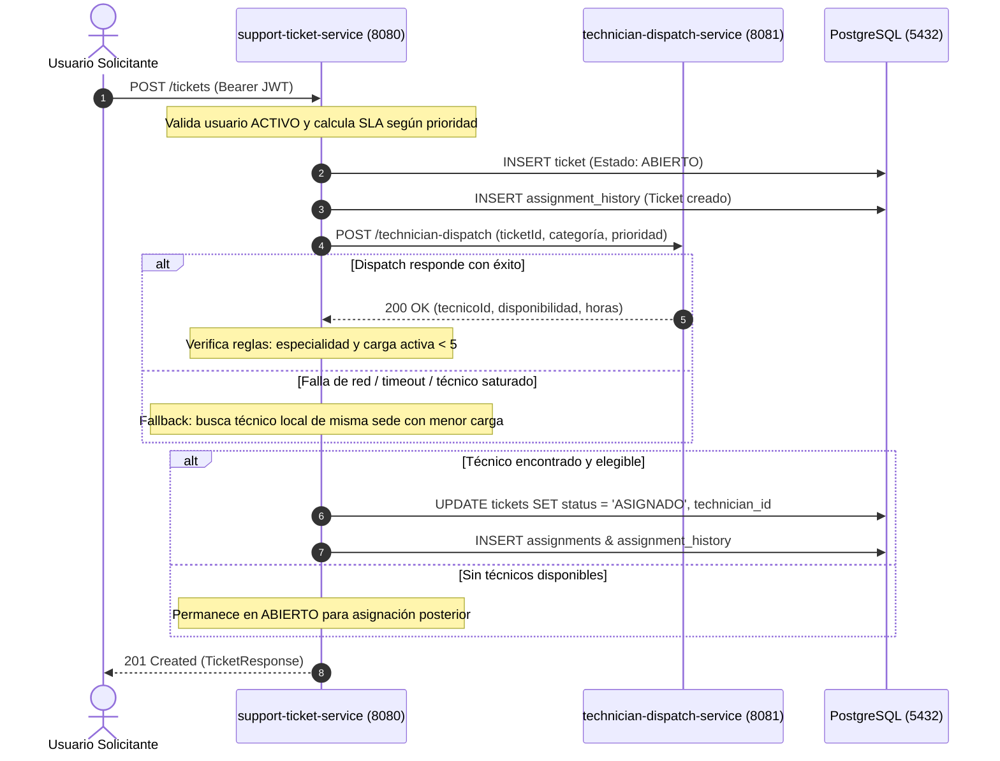
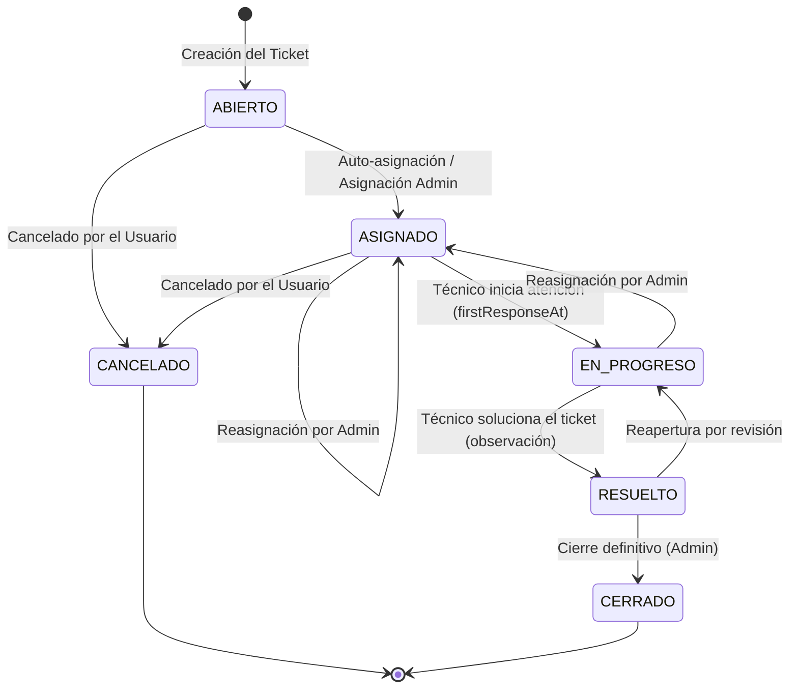

# HelpFlow - Sistema Integral de Gestión de Soporte TI

[](https://adoptium.net/)
[](https://spring.io/projects/spring-boot)
[-blue.svg)]()
[](https://www.postgresql.org/)
[](https://www.docker.com/)

**HelpFlow** es una plataforma empresarial para la gestión, priorización, asignación determinista, escalamiento automático por SLA y resolución de tickets de soporte tecnológico en organizaciones multi-sede.

El sistema está dividido en **dos microservicios desacoplados**:
* **`support-ticket-service` (Puerto 8080):** Servicio central con arquitectura hexagonal pura, persistencia JPA en PostgreSQL, migraciones automáticas con Flyway, autenticación stateless con JWT, observabilidad con Micrometer/Prometheus y respuestas de error estandarizadas RFC 7807 (`ProblemDetail`).
* **`technician-dispatch-service` (Puerto 8081):** Microservicio determinista que evalúa la categoría, prioridad e ID del ticket para predecir el técnico óptimo y su tiempo estimado de respuesta.

---

## Inicio Rápido (En 3 Pasos)

### 1. Iniciar los Servicios con Docker
En la raíz del proyecto, ejecuta:
```bash
docker compose up --build -d
```
> Esto descarga, compila y levanta automáticamente la base de datos PostgreSQL y los dos microservicios con monitoreo de salud activo (`healthy`).

### 2. Verificar la Salud del Sistema
Abre tu navegador o ejecuta en terminal:
* **Servicio Central:** [http://localhost:8080/actuator/health](http://localhost:8080/actuator/health) `{"status":"UP"}`
* **Servicio de Despacho:** [http://localhost:8081/actuator/health](http://localhost:8081/actuator/health) `{"status":"UP"}`

### 3. Explorar la API
* **Swagger UI Interactivo:** [http://localhost:8080/swagger-ui/index.html](http://localhost:8080/swagger-ui/index.html)
* **Colección Postman:** Importa el archivo [`HelpFlow.postman_collection.json`](file:///C:/Users/juang/OneDrive/Documentos/riwi-proyects/HelpFlow/HelpFlow.postman_collection.json) en la raíz del proyecto.

---

## Enlaces Clave del Entorno

| Servicio | Endpoint / Herramienta | URL |
| :--- | :--- | :--- |
| **Central (8080)** | Swagger UI | [http://localhost:8080/swagger-ui/index.html](http://localhost:8080/swagger-ui/index.html) |
| **Central (8080)** | OpenAPI JSON | [http://localhost:8080/v3/api-docs](http://localhost:8080/v3/api-docs) |
| **Central (8080)** | Health Check | [http://localhost:8080/actuator/health](http://localhost:8080/actuator/health) |
| **Central (8080)** | Métricas Prometheus | [http://localhost:8080/actuator/prometheus](http://localhost:8080/actuator/prometheus) |
| **Despacho (8081)** | Health Check | [http://localhost:8081/actuator/health](http://localhost:8081/actuator/health) |
| **Despacho (8081)** | Métricas Prometheus | [http://localhost:8081/actuator/prometheus](http://localhost:8081/actuator/prometheus) |
| **PostgreSQL** | Conexión JDBC | `localhost:5432` / BD: `helpflow_tickets` |

---

## Diagramas de Arquitectura y Flujos

### 1. Arquitectura Hexagonal (`support-ticket-service`)


---

### 2. Flujo de Creación y Auto-Despacho de Tickets



---

### 3. Ciclo de Vida y Estados del Ticket



---

## Matriz de Roles y Permisos (RBAC)

| Acción / Funcionalidad | `ROLE_USUARIO` | `ROLE_TECNICO` | `ROLE_ADMIN` |
| :--- | :---: | :---: | :---: |
| **Crear nuevo ticket** | Sí | No | Sí |
| **Consultar tickets** | Solo los propios | Solo los asignados | Todos los tickets |
| **Cancelar ticket** | Sí (con observación) | No | Sí |
| **Iniciar atención (`EN_PROGRESO`)** | No | Solo los asignados | Sí |
| **Resolver ticket (`RESUELTO`)** | No | Solo los asignados | Sí |
| **Reasignar técnico manualmente** | No | No | Sí |
| **Consultar y Modificar horas SLA** | No | No | Sí |
| **Registrar nuevos usuarios / técnicos**| No | No | Sí |

---

## Credenciales de Prueba Pre-cargadas

Todos los usuarios creados en el semillero inicial ([V3__datos_iniciales.sql](file:///C:/Users/juang/OneDrive/Documentos/riwi-proyects/HelpFlow/support-ticket-service/src/main/resources/db/migration/V3__datos_iniciales.sql)) comparten la misma contraseña:
> Contraseña general: **`admin123`**

| Rol | Correo Electrónico | Código / Especialidad | Sede | Capacidad |
| :--- | :--- | :--- | :--- | :---: |
| **Administrador** | `admin@helpflow.com` | `DOC-ADMIN-01` | Sede Central | N/A |
| **Técnico Hardware** | `tec01@helpflow.com` | `TEC-001` (HARDWARE) | Sede Central | 5 tickets |
| **Técnico Hardware** | `tec02@helpflow.com` | `TEC-002` (HARDWARE) | Sede Norte | 5 tickets |
| **Técnico Software** | `tec05@helpflow.com` | `TEC-005` (SOFTWARE) | Sede Central | 5 tickets |
| **Técnico Redes** | `tec09@helpflow.com` | `TEC-009` (RED) | Sede Central | 5 tickets |
| **Técnico Accesos** | `tec13@helpflow.com` | `TEC-013` (ACCESOS) | Sede Central | 5 tickets |
| **Técnico General** | `tec17@helpflow.com` | `TEC-017` (OTRO) | Sede Central | 5 tickets |

*(Hay un total de 20 técnicos registrados de `TEC-001` a `TEC-020` distribuidos uniformemente entre sedes Central, Norte, Sur y Occidente).*

---

## Demostración Rápida de la API

### 1. Iniciar Sesión (Login)
```bash
curl -X POST http://localhost:8080/auth/login \
  -H "Content-Type: application/json" \
  -d '{"email":"admin@helpflow.com","password":"admin123"}'
```
> **Respuesta:** Devuelve el JSON con el `token` JWT Bearer y datos del usuario autenticado.

---

### 2. Crear un Ticket con Auto-Asignación
```bash
curl -X POST http://localhost:8080/tickets \
  -H "Authorization: Bearer <TU_TOKEN_JWT>" \
  -H "Content-Type: application/json" \
  -d '{
    "title": "Falla de conectividad en switch",
    "description": "Switch de sala de juntas sin enlace de red",
    "category": "RED",
    "priority": "ALTA",
    "site": "Sede Central",
    "area": "Infraestructura"
  }'
```
> **Resultado:** El ticket se crea inmediatamente en estado `ASIGNADO` y vinculado al técnico que determinó el microservicio de despacho.

---

### 3. Actualizar el Estado del Ticket
```bash
curl -X PATCH http://localhost:8080/tickets/1/status \
  -H "Authorization: Bearer <TU_TOKEN_JWT>" \
  -H "Content-Type: application/json" \
  -d '{
    "status": "EN_PROGRESO",
    "observation": "Inicio de diagnóstico de cables y puertos del switch"
  }'
```

---

## Métricas de Negocio y Observabilidad

El microservicio central expone métricas de dominio mediante Micrometer y Prometheus:

* **`helpflow.tickets.created`:** Contador de tickets creados por categoría y prioridad.
* **`helpflow.tickets.overdue`:** Medidor en tiempo real (Gauge) de tickets con fecha límite de SLA vencida.
* **`helpflow.tickets.first_response_time`:** Temporizador (Timer) del tiempo transcurrido hasta la primera respuesta técnica.
* **`helpflow.tickets.resolution_time`:** Temporizador (Timer) del tiempo total hasta la resolución del ticket.

Consulta de métricas:
```bash
# Formato JSON con detalles
curl http://localhost:8080/actuator/metrics/helpflow.tickets.overdue

# Scraping para Prometheus
curl http://localhost:8080/actuator/prometheus
```

---

## Ejecución de Pruebas Unitarias y de Integración

Si deseas compilar y ejecutar las pruebas de software de manera local:

```powershell
# Pruebas de support-ticket-service:
cd support-ticket-service
$env:JAVA_HOME = "C:\Program Files\Eclipse Adoptium\jdk-21.0.12.8-hotspot"
.\mvnw.cmd test

# Pruebas de technician-dispatch-service:
cd ..\technician-dispatch-service
$env:JAVA_HOME = "C:\Program Files\Eclipse Adoptium\jdk-21.0.12.8-hotspot"
.\mvnw.cmd test
```

---

## Detener y Limpiar el Entorno

Para detener los contenedores preservando los datos:
```bash
docker compose down
```

Para reiniciar con base de datos limpia desde cero:
```bash
docker compose down -v
docker compose up --build -d
```
